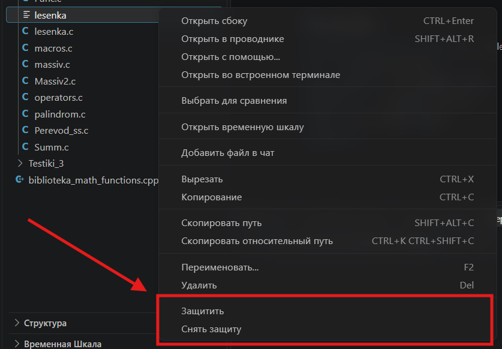
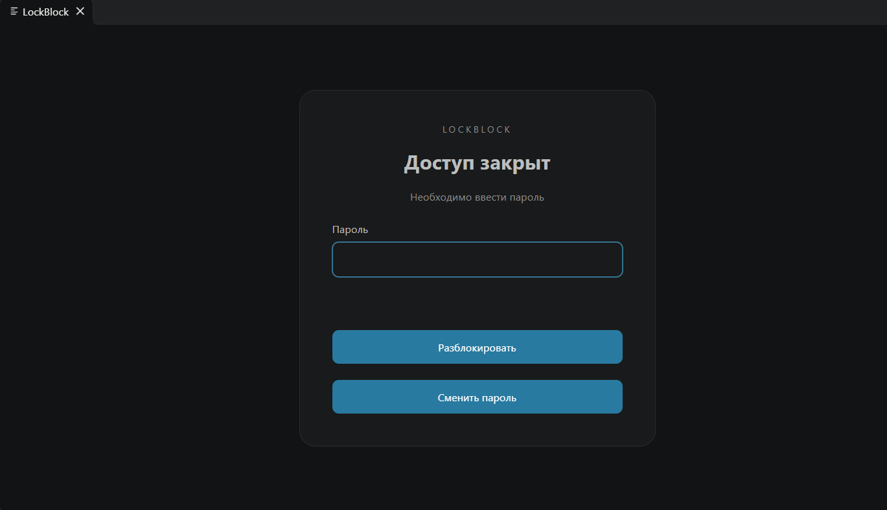
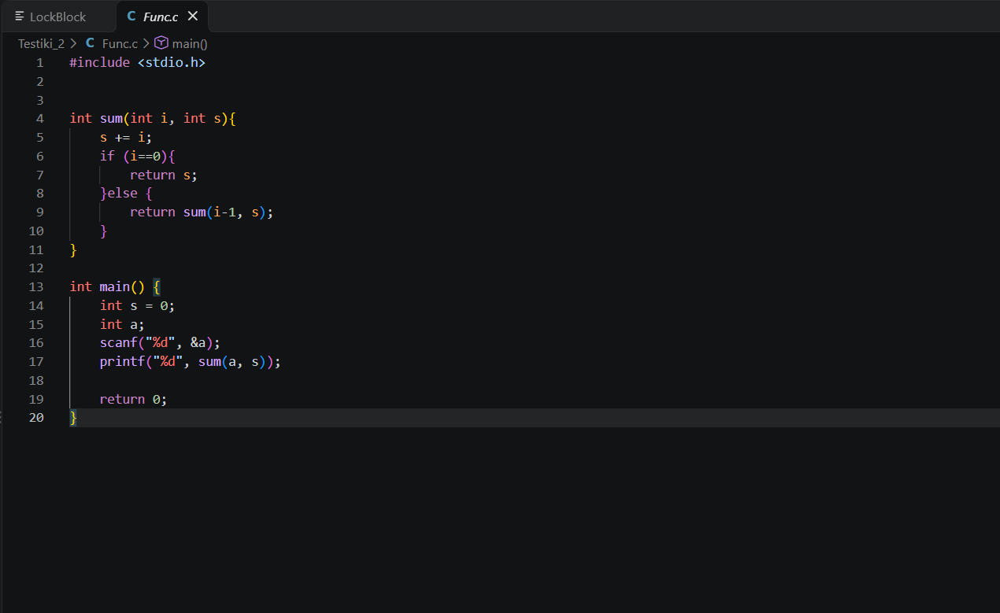
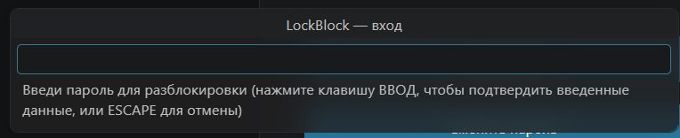
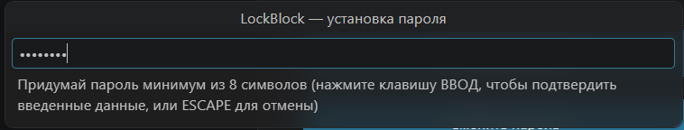
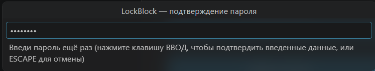
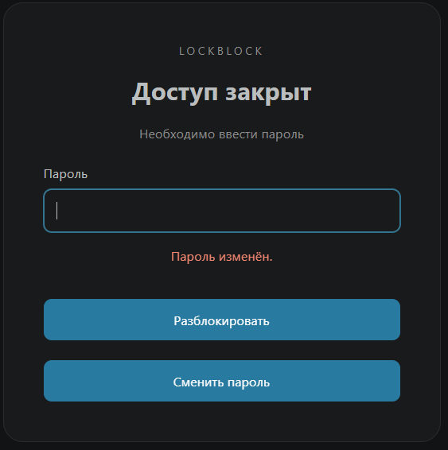

# LockBlock

LockBlock — защитник ваших репозиториев, если вы безответственный разработчик и можете спокойно оставить рабочий ноутбук с открытым кодом проекта всем напоказ.😇😇😇 
Расширение позволяет закрывать выбранные файлы и папки экраном с паролем внутри VS Code.

## Основные функции

- Блокировка отдельных файлов и целых папок.
- Разблокировка выбранного объекта по паролю.
- Снятие защиты с файла или папки вместе с её содержимым.
- Смена пароля с подтверждением текущего.

Пароль один на всё расширение в текущем профиле VS Code. При этом доступ выдаётся отдельно: разблокировка одной защищённой папки не открывает другие независимо защищённые папки.

## Установка

1. Скачайте файл `LockBlock-1.6.vsix` из репозитория.
2. Откройте расширения VS Code: **Ctrl+Shift+X**.
3. Нажмите **«…» → «Установить из VSIX…»**.
4. Выберите скачанный `.vsix` файл и перезагрузите окно.

## Использование

### Защитить файл или папку

ПКМ на объект в дереве проекта и выберите **Защитить**.

При первом использовании расширение предложит создать пароль. Если пароль уже установлен, то будет использоваться он.

При открытии защищённого файла появится влкадка с окном для ввода пароля. Доступ к выбранному файлу или папке откроется только после успешного подтверждения личности паролем.

### Снять защиту

ПКМ на объект, выберите **Снять защиту** и введите пароль.

Снятие защиты с папки распространяется на всё её содержимое. Снятие защиты с отдельного файла не меняет защиту остальных файлов, родительских и соседних папок.

### Сменить пароль

На карточке нажмите **«Сменить пароль»**. Введите текущий пароль, затем новый дважды.

Новый пароль применяется ко всем защищённым объектам. Закрытые объекты остаются закрытыми.Уже разрешённый доступ сохраняется до повторной блокировки или перезапуска. Отмена смены пароля сохраняет прежний пароль.

## Примеры использования
















## Как проверяется пароль

При установке пароля создаётся случайная **СОЛЬ**, затем с помощью `scrypt` вычисляется **ХЭШ** — проверочное значение пароля.

```text
Пароль + СОЛЬ → scrypt → ХЭШ
```

Исходный пароль не сохраняется: в защищённом хранилище VS Code находятся **СОЛЬ** и **ХЭШ**. При входе расширение повторяет вычисление с введённым паролем и сохранённой солью, после чего сравнивает результаты.

Это защищает пароль от простого просмотра сохранённой записи. **СОЛЬ** мешает использовать заранее рассчитанные таблицы, а `scrypt` увеличивает затраты на подбор пароля. Соль не является секретом.

Подробнее: 
(сам брал отсюда)

1. [«Солим пароли» — Хабр](https://habr.com/ru/articles/145648/).
2. [«Безопасное проектирование программного обеспечения: Хеширование и salting» — Хабр](https://habr.com/ru/companies/otus/articles/822953/).

(В статьях описана идея и ее применение. В LockBlock для вычисления проверочного значения используется `scrypt`).

## Поддерживаемые файлы

- Текстовые файлы, включая исходный код.
- Изображения.
- Блокноты (notebooks).

В зависимости от версии VS Code и используемого редактора поддержка остальных форматов не гарантируется.

## ВАЖНО

Расширение не заменяет блокировку компьютера.
LockBlock работает внутри интерфейса VS Code: он не блокирует файлы на уровне операционной системы и не запрещает открывать их через проводник, терминал или другие программы. Содержимое файлов тоже никак не шифруется (но я не ИБ, простите меня).
